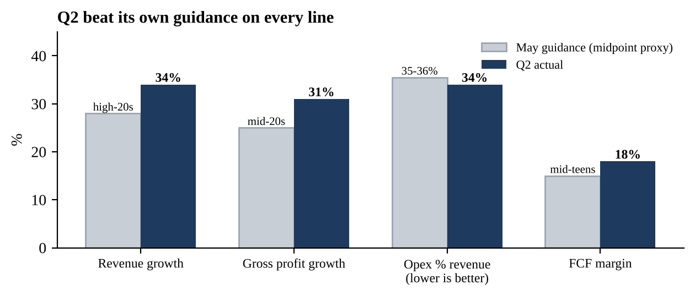
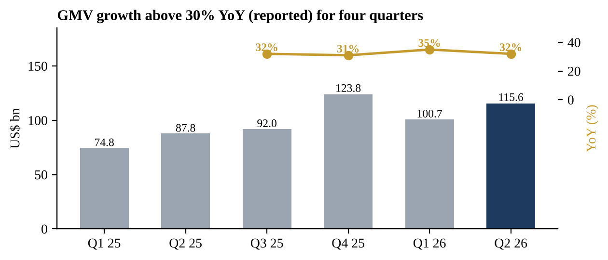
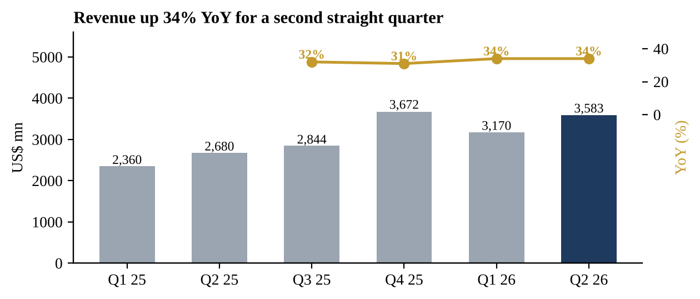
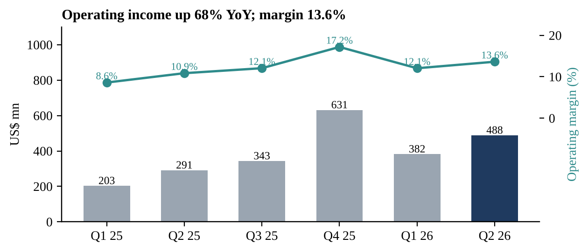
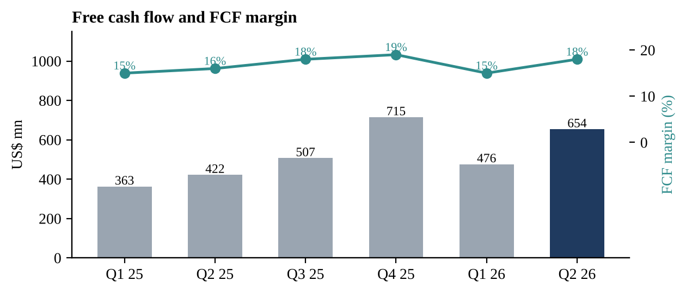
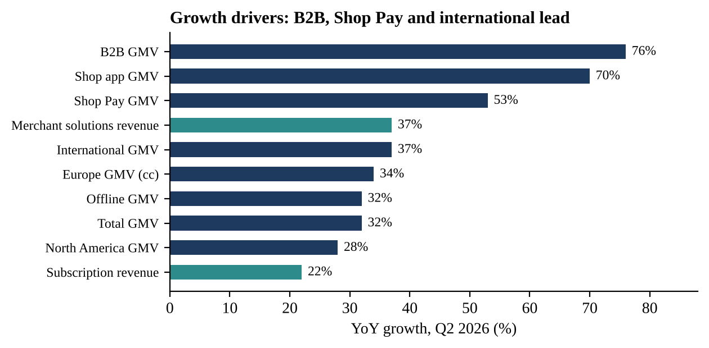
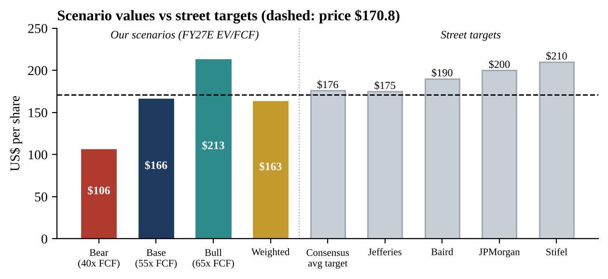

# Shopify Q2 2026 Earnings Update

An earnings update on **Shopify Inc (Nasdaq/TSX: SHOP)** covering Q2 2026 results, reported on **5 August 2026**. It covers the beat against consensus and against company guidance, the drivers behind it, the Q3 outlook ahead of results on 3 November, updated FY26–27 estimates, and a scenario-based valuation.

📄 **[Read the full report (PDF)](report/shopify-equity-research.pdf)**

---

## Summary

The core view: **a clean beat with 30%-plus growth and operating leverage, but the share price has caught up.**

| US$ mn | Q2 2026 | Q2 2025 | YoY | Consensus | vs cons. |
|---|---:|---:|---:|---:|---:|
| GMV ($ bn) | 115.6 | 87.8 | +32% | | |
| Revenue | 3,583 | 2,680 | +34% | ~3,450 | +4% |
| Operating income | 488 | 291 | +68% | | |
| Free cash flow margin | 18% | 16% | +2pp | | |
| Adjusted EPS ($) | 0.42 | | | 0.37–0.40 | +5–14% |

- **Beat its own guidance on every line:** revenue, gross profit, opex and FCF margin.
- **Broad growth:** international GMV +37%, B2B +76%, offline +32%, Shop Pay +53%. Payments penetration reached 68% of GMV.
- **Operating leverage:** opex fell to 34% of revenue from 38%, offsetting a gross margin that slipped to 47.7%.
- **Q3 guide:** low-thirties revenue growth, opex at 33–34% of revenue, FCF margin in the high teens to low twenties.

## Estimates and valuation

| US$ mn | FY25A | FY26E | FY27E |
|---|---:|---:|---:|
| Revenue | 11,556 | 15,207 | 19,009 |
| Operating income | 1,468 | 2,038 | 2,946 |
| Free cash flow | 2,007 | 2,830 | 3,802 |

| Scenario | FY27E EV/FCF | Value per share |
|---|---:|---:|
| Bear | 40x | $106 |
| Base | 55x | $166 |
| Bull | 65x | $213 |
| **Probability-weighted** | | **$163** (vs $170.8 on 22 Oct 2026) |



## What's in the report

1. **The quarter:** beats against the street and against guidance
2. **What drove it:** growth drivers, AI, margins, capital return
3. **Q3 outlook:** what to watch on 3 November
4. **Thesis update:** what would push the stock higher, what would hurt
5. **Estimates and valuation:** FY26–27 estimates, three scenarios, street targets, catalysts and risks

## Charts

| | |
|---|---|
|  |  |
|  |  |
|  |  |

## Method and sources

- **Data:** Shopify's own press releases filed with the SEC (Form 8-K), plus coverage of the earnings call. Every figure and chart in the report is cited with a hyperlink.
- **Consensus:** compared across providers (Benzinga, Investing.com, StockStory). The differences are noted in the report.
- **Estimates:** quarterly build for FY26 from company guidance; FY27 assumes 25% revenue growth and a 20% FCF margin. Valuation uses FY27E EV/FCF across three probability-weighted scenarios.
- **Tools:** Python (matplotlib) for charts, Word for the report. AI tools helped with research and source gathering.

## Repository structure

```
├── README.md
├── report/
│   ├── shopify-equity-research.pdf
│   └── shopify-equity-research.docx
└── charts/
    └── 01–10 chart images used in the report
```

## Disclaimer

This is an independent learning project, not affiliated with any institution or firm. The rating, estimates and scenarios are illustrative, rely on public sources, and are **not investment advice** or a recommendation to buy or sell any security.

---

*Prepared by Bishal · MBA, IIM Kozhikode · October 2026*
